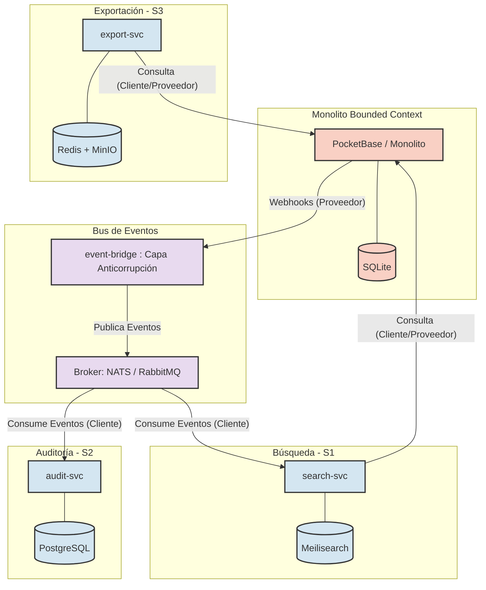
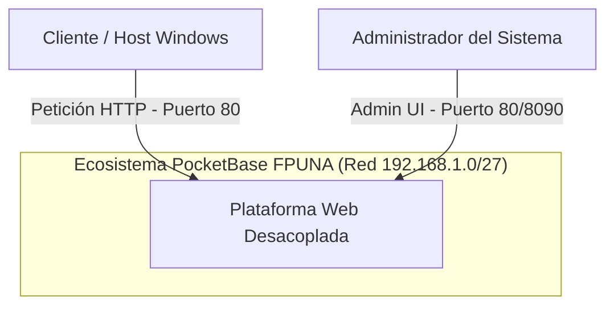
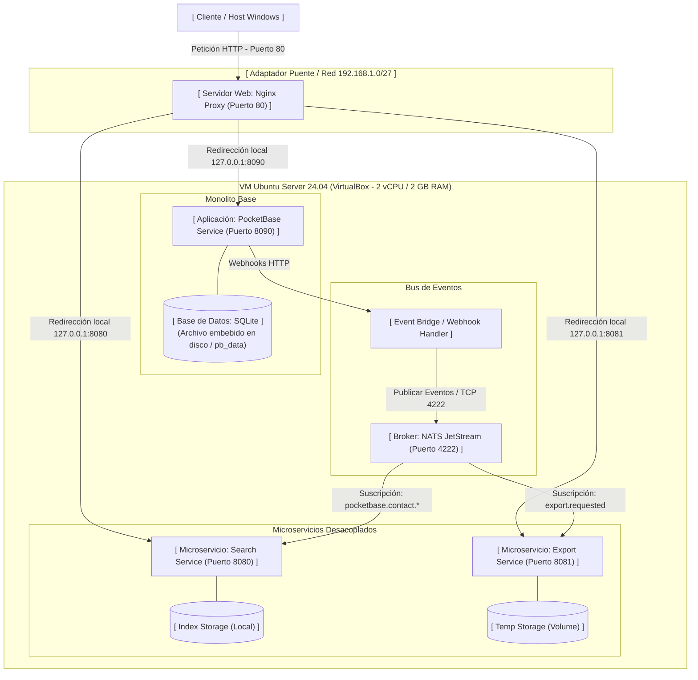
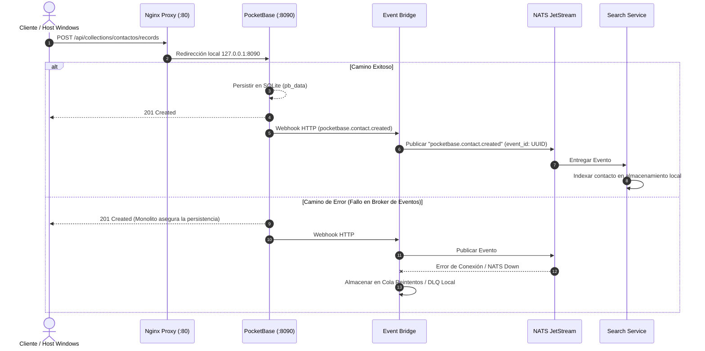
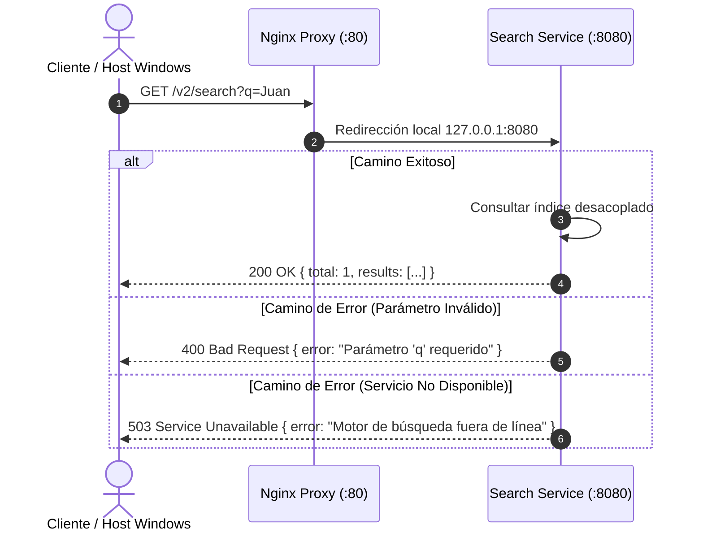
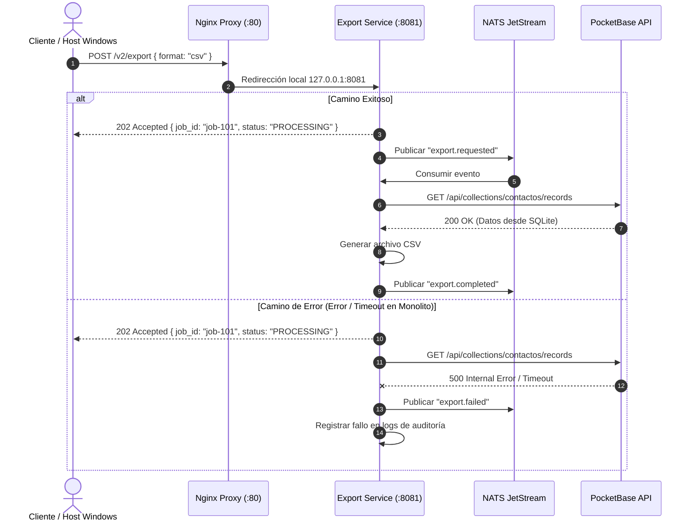
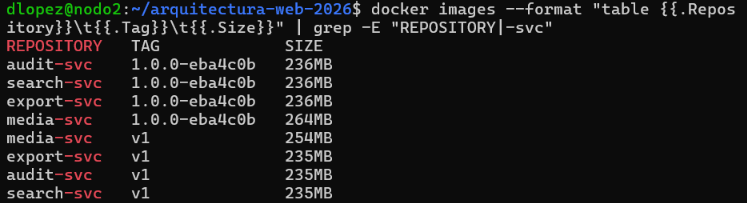
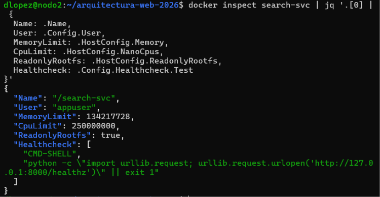

# Proyecto Integrador II — De monolito a Cloud Native

**Estudiantes:** David López, Junior Legal  
**Institución:** Facultad Politécnica - Universidad Nacional de Asunción (FPUNA)  
**Sistema Operativo:** Ubuntu Server 24.04.5 LTS (x86_64)  
**Infraestructura:** VirtualBox (2 vCPU, 2 GB RAM, 20 GB Disk)  

---

## Entrega 2. Evolución de la Infraestructura y Actualizaciones

| Criterio | Detalle |
| :--- | :--- |
| **Nombre** | PocketBase |
| **Repositorio Oficial** | [ganigeorgiev.com/pocketbase/pocketbase/releases](https://ganigeorgiev.com/pocketbase/pocketbase/releases) |
| **Versión Instalada / Actualizada** | `v0.22.58` |
| **Licencia** | MIT License |

---
# Bloque I – Fase 5: Diseño y Descomposición del Monolito

## 4.1. A1 – Análisis del Monolito y Mapa de Contextos

### Inventario de Módulos Funcionales y Tablas (Evidencia F5-E1)

Se inspeccionó la base de datos embebida SQLite de PocketBase (`data.db`) ejecutando la consulta sobre la tabla maestra `sqlite_master`:


---

### Matriz de Acoplamiento Módulo × Tabla (Evidencia F5-E2)

Dado que la arquitectura base utiliza PocketBase (SQLite), el acoplamiento se evalúa entre los servicios lógicos consumidos y las colecciones internas del motor. Las tablas compartidas o de uso cruzado determinan la complejidad de extracción hacia nuevos servicios.

| Módulo / Servicio Lógico | Colección / Tabla (PocketBase) | Operaciones (CRUD) | Nivel de Acoplamiento | Justificación del Acoplamiento |
| :--- | :--- | :--- | :--- | :--- |
| **Módulo de Autenticación** | `users`, `_admins` | Lectura (R), Actualización (U) | **Alto** | El servicio de inicio de sesión depende estrictamente de la validación contra estas tablas mediante la API nativa. |
| **Integraciones Sociales** | `_externalAuths` | Creación (C), Lectura (R) | **Medio** | Se acopla solo si se habilita el inicio de sesión con proveedores externos (Google, GitHub, etc.). |
| **Módulo de Formularios / CRM** | `contactos` | Creación (C), Lectura (R), Actualización (U), Borrado (D) | **Alto** | La interfaz de usuario que captura o lista contactos realiza peticiones REST/Realtime directamente hacia esta colección. |
| **Core (PocketBase Engine)** | `_collections`, `_migrations`, `_params` | Todas (CRUD) | **Alto (Interno)** | Son tablas de configuración estrictamente acopladas al motor interno de PocketBase para definir el esquema y estado de la base de datos. |

---

### Mapa de Contextos / DDD (Evidencia F5-E3)

El siguiente mapa de contextos ilustra las relaciones entre el monolito original y los nuevos *Bounded Contexts* (microservicios S1, S2, S3) extraídos mediante el patrón *Strangler Fig*, destacando el `event-bridge` como Capa Anticorrupción (ACL) para desacoplar la emisión de webhooks.


---

# 4.2. A2 – Registro de Decisiones de Arquitectura (ADR-006 a ADR-010)

### ADR-006: Estrategia de Migración e Integración con el Monolito

* **Estatus:** Aprobado
* **Contexto:** El monolito basado en PocketBase debe mantenerse en producción y operando sin interrupciones mientras se realiza la extracción progresiva de funcionalidades hacia microservicios.
* **Decisión:** Adoptar el patrón **Strangler Fig** utilizando integración exclusiva mediante la API REST nativa de PocketBase y Webhooks, sin modificar el código base del binario del monolito.
* **Alternativas Descartadas:** 
  * *Modificación del core de PocketBase:* Descartado debido a que alterar el código fuente en Go del monolito incrementa el acoplamiento y dificulta futuras actualizaciones del motor base.
* **Consecuencias:** 
  * *Positivas:* Riesgo operativo mínimo durante la migración; permite desplegar y validar microservicios de forma independiente.
  * *Negativas:* Requiere configurar una capa intermedia (`event-bridge`) para transformar webhooks de PocketBase en eventos asíncronos.

---

### ADR-007: Selección del Broker de Mensajes

* **Estatus:** Aprobado
* **Contexto:** Se requiere un bus de mensajería para garantizar la entrega confiable de eventos entre el `event-bridge` y los microservicios consumidores (Búsqueda, Auditoría, Exportación).
* **Decisión:** Seleccionar **NATS JetStream** como broker principal de eventos.
* **Alternativas Descartadas:** 
  * *RabbitMQ:* Descartado por su elevado consumo de memoria RAM y complejidad operativa para el entorno de recursos limitados.
  * *Redis Streams:* Descartado por carecer de mecanismos nativos más avanzados para la persistencia de streams a largo plazo comparado con JetStream.
* **Consecuencias:** 
  * *Positivas:* Huella de memoria sumamente baja (< 20 MB RAM), alto rendimiento en throughput y persistencia nativa con JetStream.
  * *Negativas:* Menor ecosistema de librerías en comparación con RabbitMQ.

---

### ADR-008: Plataforma de Orquestación

* **Estatus:** Aprobado
* **Contexto:** La infraestructura asignada se limita a máquinas virtuales en VirtualBox con 2 vCPU, 2 GB de RAM y 20 GB de Disco sobre Ubuntu Server 24.04.4 LTS.
* **Decisión:** Utilizar **Docker Compose** como motor de orquestación y despliegue del entorno.
* **Alternativas Descartadas:** 
  * *k3s (Lightweight Kubernetes):* Descartado porque el consumo base del plano de control en memoria RAM sobrepasa la capacidad disponible (2 GB RAM) e inestabiliza los nodos.
  * *Docker Swarm:* Descartado por añadir complejidad sintáctica no requerida para el entorno mono-nodo actual.
* **Consecuencias:** 
  * *Positivas:* Consumo insignificante de recursos de sistema, sintaxis declarativa simple y rápido ciclo de despliegue sobre Ubuntu Server 24.04.4 LTS.
  * *Negativas:* Ausencia de autoscaling automático y orquestación multi-nodo avanzada.

---

### ADR-009: Base de Datos por Servicio (Database per Service)

* **Estatus:** Aprobado
* **Contexto:** Los nuevos microservicios extraídos necesitan persistir su información sin depender del esquema interno o la base de datos SQLite del monolito PocketBase (`pb_data/data.db`).
* **Decisión:** Aplicar estrictamente el patrón **Database per Service**, prohibiendo el acceso directo de los microservicios al archivo SQLite de PocketBase.
* **Alternativas Descartadas:** 
  * *Base de datos compartida (Shared SQLite):* Descartado debido a los bloqueos de escritura concurrentes (`database is locked`) propios de SQLite y el acoplamiento fuerte de modelos.
* **Consecuencias:** 
  * *Positivas:* Autonomía completa del modelo de datos de cada microservicio; eliminación del punto único de falla en almacenamiento.
  * *Negativas:* Se requiere gestionar consistencia eventual entre la base de datos de PocketBase y los nuevos almacenes.

---

### ADR-010: Consistencia Eventual e Idempotencia

* **Estatus:** Aprobado
* **Contexto:** Las operaciones de actualización hacia los servicios desacoplados se procesan de forma asíncrona a través del bus de eventos.
* **Decisión:** Implementar un modelo de **Consistencia Eventual** garantizando idempotencia en los consumidores mediante `event_id` único y gestionando fallos con colas de mensajes no procesables (Dead Letter Queue - DLQ).
* **Alternativas Descartadas:** 
  * *Transacciones distribuidas (2PC / Two-Phase Commit):* Descartadas por su alta latencia y baja tolerancia a fallos en arquitecturas orientadas a eventos.
* **Consecuencias:** 
  * *Positivas:* Alta disponibilidad y resiliencia; los eventos duplicados o fuera de orden no corrompen el estado del sistema.
  * *Negativas:* Existencia de un breve desfase de milisegundos hasta que los datos se reflejen totalmente en los servicios secundarios.

---

# 4.3. A3 – Contratos de API y de Eventos

## Política de Versionado
Para garantizar la retrocompatibilidad y no romper a los consumidores existentes (frontend u otros microservicios):
- **API REST:** Todas las nuevas rutas extraídas del monolito de PocketBase se exponen bajo el prefijo `/v2/` (ej. `/v2/search`, `/v2/export`).
- **Eventos (Mensajería):** Todos los eventos asíncronos incluyen un campo `version` en su sobre común (ej. `"version": "1.0.0"`).
- **Transición a v3 sin romper consumidores:** 
  - **APIs REST:** Si en el futuro se requiere un cambio disruptivo (*breaking change*), se desplegará una nueva ruta `/v3/` (ej. `/v3/search`). Los endpoints `/v2/` seguirán funcionando en paralelo en el mismo microservicio o enrutador durante un periodo de transición, permitiendo a los clientes migrar a su propio ritmo.
  - **Eventos Asíncronos:** Los nuevos eventos se publicarán con el campo `"version": "2.0.0"` en el sobre. Los consumidores existentes estarán programados bajo el principio de robustez (ignorando campos desconocidos o filtrando por la versión soportada), permitiendo la emisión paralela sin afectar los procesos activos.

---

## Contratos OpenAPI 3.1 (REST) y AsyncAPI 3.0 (Eventos)
Los esquemas completos con esquemas de datos, códigos de respuesta (200, 202, 400, 404, 503) y el diseño del sobre de eventos común (`event_id`, `type`, `version`, `occurred_at`, `request_id`, `payload`) se encuentran disponibles y validados en el directorio `cna/contracts/`:

- **Contrato de Búsqueda:** `cna/contracts/search-svc.openapi.yaml`
- **Contrato de Exportación:** `cna/contracts/export-svc.openapi.yaml`
- **Bus de Eventos (PocketBase):** `cna/contracts/events.asyncapi.yaml`

---

## Evidencia de Validación (Evidencia F5-E4)

Se ejecutó la validación del contrato OpenAPI utilizando la herramienta **Spectral** dentro del repositorio local en la máquina virtual:


---

# C4 - Nivel 1: Diagrama de Contexto (F5-E5)



## C4 - Nivel 2: Diagrama de Contenedores (F5-E6)



## Diagramas de Secuencia (F5-E7)

### 1. Sincronización Eventual de Contactos (Creación / Actualización)



### 2. Búsqueda Desacoplada de Contactos



### 3. Exportación Asíncrona de Datos


---

# 4.5. A5 – Plan de Migración y Matriz de Riesgos

### 1. Orden de Extracción Justificado (Menor a Mayor Riesgo)

El desacoplamiento del monolito PocketBase se realiza en fases incrementales para minimizar el impacto en el negocio:

| Fase | Servicio / Módulo | Nivel de Riesgo | Justificación técnica | Criterio de "Hecho" (Definition of Done) |
| :--- | :--- | :--- | :--- | :--- |
| **Paso 1** | **Servicio de Exportación (`export-svc`)** | **Bajo** | Operación de solo lectura asíncrona y no crítica para las transacciones inmediatas del usuario. | El servicio procesa eventos `export.requested` desde NATS JetStream, genera reportes en background y los deposita en el volumen local. |
| **Paso 2** | **Servicio de Búsqueda (`search-svc`)** | **Medio** | Extrae las consultas de búsqueda de la base de datos principal SQLite (`pb_data`), aliviando bloqueos de lectura. | El índice desacoplado procesa eventos `pocketbase.contact.*` con 0 errores y atiende `/v2/search` con latencia < 50ms. |
| **Paso 3** | **Servicio de Auditoría (`audit-svc`)** | **Alto** | Registra trazas de operaciones críticas. Al ser altamente dependiente de webhooks, requiere validar el manejo de fallos y DLQ. | El 100% de los cambios de estado en PocketBase generan registros de auditoría persistentes de forma asíncrona sin ralentizar las respuestas HTTP. |

---

### 2. Estrategia de Reversión (Rollback en < 1 minuto)

Para desactivar inmediatamente cualquier ruta `/v2/*` redirigida en el API Gateway (Nginx Proxy) y retornar la atención de tráfico directamente al monolito PocketBase:

1. **Procedimiento de Desactivación:**
   Se dispone de una plantilla de configuración de Nginx (`nginx.conf.bak`) preconfigurada que redirige todas las llamadas `/v2/` a las colecciones nativas de PocketBase (`/api/collections/`).

2. **Comando de Rollback (Ejecución en terminal):**
   ```bash
   cp /etc/nginx/templates/rollback-v1.conf /etc/nginx/conf.d/default.conf && nginx -s reload

3. **Mecanismo de Conmutación:**
   Al ejecutar `nginx -s reload`, Nginx recarga la configuración en memoria de forma instantánea (**< 1 segundo**) sin perder conexiones activas. El tráfico `/v2/search` pasa a atenderse directamente mediante la API nativa de PocketBase sobre SQLite.

---

## 3. Matriz de Riesgos (Probabilidad × Impacto)

Evaluación detallada de riesgos de arquitectura sobre la infraestructura asignada (2 vCPU, 2 GB RAM sobre VirtualBox / FPUNA):

| Riesgo | Probabilidad | Impacto | Nivel (P × I) | Estrategia de Mitigación / Contención |
| :--- | :---: | :---: | :---: | :--- |
| **Consistencia eventual visible al usuario** | Media (3) | Medio (3) | **Medio (9)** | Implementar *Optimistic UI* en el frontend y polling/WebSockets notificando la finalización del procesamiento asíncrono. |
| **Consumo excesivo de RAM** | Alta (4) | Alto (4) | **Alto (16)** | Límite estricto de recursos en `docker-compose.yml` (`mem_limit: 256m` por servicio) y selección de componentes ultraligeros (PocketBase + NATS). |
| **Latencia de red entre VM** | Baja (1) | Medio (3) | **Bajo (3)** | Despliegue de los contenedores dentro de la misma red interna de Docker (`docker network`) sobre la VM `equipo-vm`. |
| **Secretos compartidos (Hardcoded)** | Media (3) | Alto (4) | **Alto (12)** | Inyección de credenciales mediante variables de entorno en archivo `.env` restringido (excluido del repositorio Git por `.gitignore`). |
| **Punto único de falla en el Gateway** | Media (3) | Crítico (5) | **Alto (15)** | Monitoreo continuo mediante healthchecks de Docker (`restart: always`) y archivo de configuración estandarizado para rollback inmediato. |

---

## 5.1. B1 – Infraestructura Multi-Nodo

### Descripción del Entorno
Se ha configurado una infraestructura distribuida compuesta por dos máquinas virtuales Ubuntu Server 24.04 sobre VirtualBox:
* **VM-1 (Gateway / Monolito Core):** `equipo-vm` (IP: `192.168.1.25/27`) - Encargada de recibir el tráfico HTTP/HTTPS externo y ejecutar la API principal de PocketBase sobre SQLite.
* **VM-2 (Clúster Worker / Microservicios):** `equipo-vm2` (IP: `192.168.1.26/27`) - Clon enlazado configurado para hospedar de forma aislada los microservicios desacoplados y el bus de eventos.

---

# Bloque II – Fase 6: Construcción, Contenerización y Despliegue Distribuido
---

# 5.1. B1 - Infraestructura Multi-Nodo

#### 1. Evidencia F6-E1: Inspección de Recursos y Docker Engine (VM-1 / VM-2)
Confirmación del entorno de ejecucion Docker en los nodos distribuidos (2 vCPU, 2 GB RAM, Kernel Linux 6.8):


#### 2. Evidencia F6-E2: Reglas de Firewall UFW por Nodo (VM-2)
Aislamiento estricto de seguridad en VM-2: los puertos internos de los microservicios (8080/tcp, 8081/tcp) y del bus NATS (4222/tcp) únicamente aceptan peticiones originadas desde la dirección IP de VM-1 (192.168.1.25):


#### 3. Evidencia F6-E3: Inspección del Certificado X.509 con SAN (VM-1)
Certificado SSL/TLS reemitido incorporando los nombres de dominio de PocketBase en la extensión Subject Alternative Name (SAN):


---

## 5.2. B2 – Microservicios y Bus de Eventos

### Resumen de Despliegue en VM-2 (192.168.1.26)
Los cuatro microservicios (`search-svc`, `audit-svc`, `export-svc`, `media-svc`) han sido desplegados desacoplados en el nodo Worker (VM-2), consumiendo variables de entorno, exponiendo endpoints de resiliencia (`/healthz`, `/readyz`), métricas Prometheus (`/metrics`) e inyectando `X-Request-ID`.

---

### Evidencias de Ejecución

#### 1. Evidencia F6-E4: Servicio de Búsqueda (search-svc)
Consulta al endpoint `/v2/search` procesada correctamente a través de los índices de PocketBase:


#### 2. Evidencia F6-E5: Idempotencia en Audit Service (audit-svc)
Verificación de control de duplicados mediante `event_id`. El primer evento es registrado (`201 Created`), mientras que el duplicado es ignorado (`200 OK` - `ignored`):


#### 3. Evidencia F6-E6: Procesamiento Asíncrono en Export Service (export-svc)
Recepción de solicitud de exportación retornando `202 Accepted` y el identificador único del trabajo (`job_id`):


#### 4. Evidencia F6-E8: Procesamiento de Archivos en Media Service (media-svc)
Confirmación de carga de medios con emisión del evento `media.uploaded` y generación de miniaturas:


---

### 5.3. B3 – Contenerización con Buenas Prácticas

En esta sección se rediseñó la estrategia de contenerización de los microservicios aplicando un enfoque de mínima superficie de ataque y optimización de recursos, cumpliendo con los siguientes criterios:

*   **Dockerfile Multi-stage:** Se implementó un *builder* temporal para compilar dependencias (`wheels`), dejando una imagen final `python:3.11-slim` limpia y ligera.
*   **Seguridad:** Ejecución con el usuario sin privilegios `appuser` (no-root) y sistema de archivos montado como solo lectura (`read_only: true`), utilizando `/tmp` para escrituras efímeras.
*   **Tolerancia a fallos:** Incorporación de la instrucción `HEALTHCHECK` en Dockerfile, sondeando el endpoint `/healthz` de forma nativa.
*   **Versionamiento:** Despliegue seguro prohibiendo la etiqueta `:latest`. Se utilizó versionamiento semántico ligado al hash del commit (Ej: `1.0.0-eba4c0b`).
*   **Límites (Cgroups):** Contenedores restringidos por diseño a `0.25` CPUs y `128m` de memoria RAM, garantizando que el sumatorio (512MB RAM) no sature el nodo.

<details open>
<summary>📸 <b>Evidencia F6-E9: Tabla de Imágenes y Tamaño</b></summary>
<br>

Listado de los microservicios compilados, mostrando el uso estricto de versionamiento semántico y la reducción de tamaño de las imágenes.



</details>

<details open>
<summary>📸 <b>Evidencia F6-E10: Inspección de Seguridad y Límites (docker inspect)</b></summary>
<br>

Validación mediante `docker inspect` al contenedor `search-svc` demostrando: usuario `appuser`, límite de RAM en bytes (128MB), límite de CPU (0.25), `ReadonlyRootfs: true` y la definición explícita del `HEALTHCHECK`.



</details>
