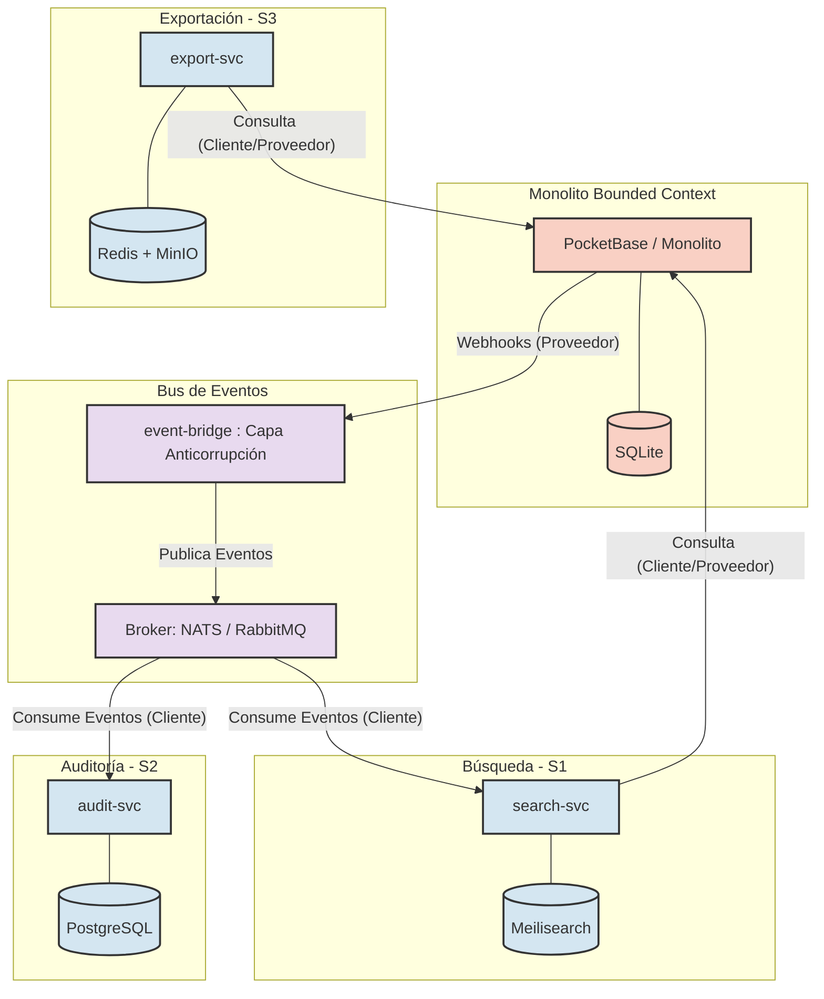
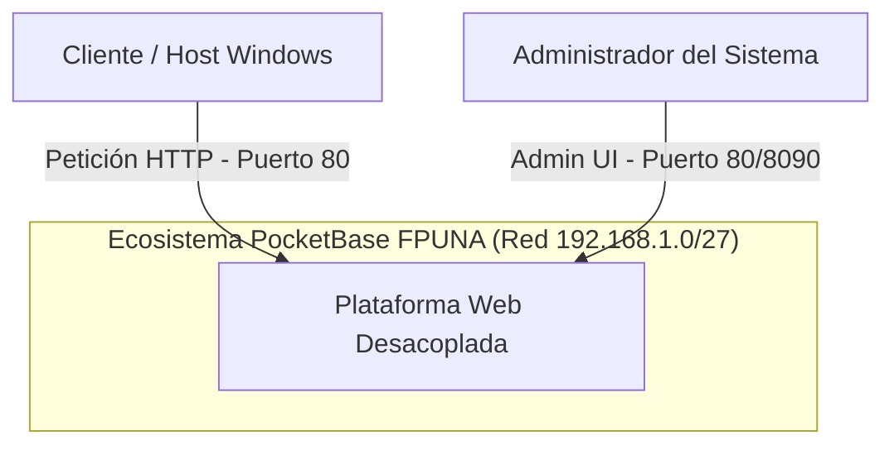
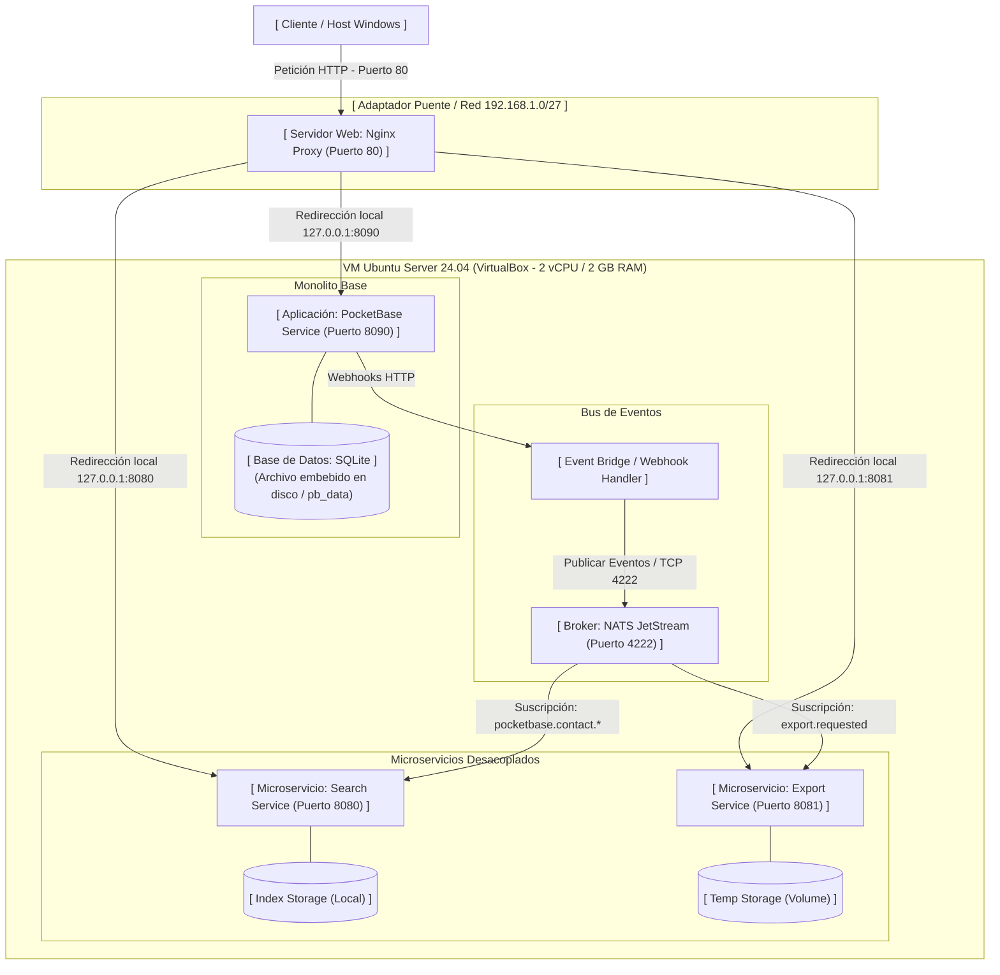
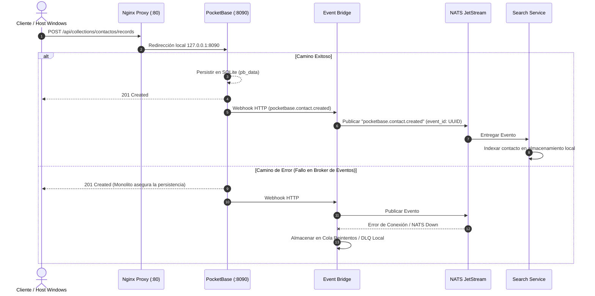
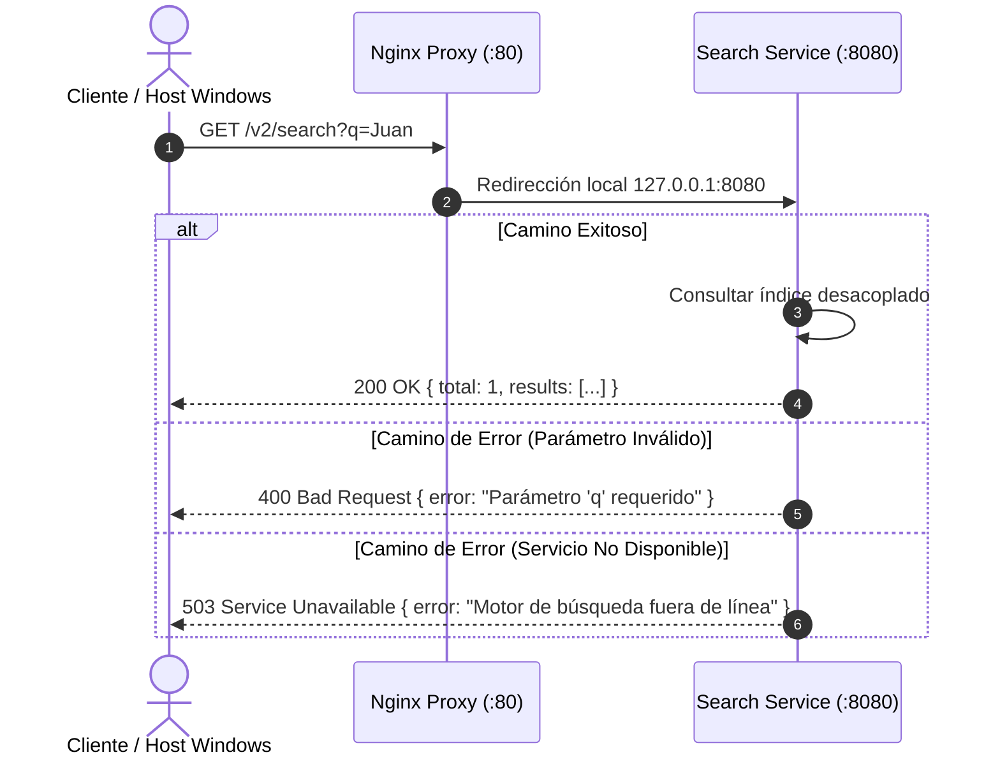
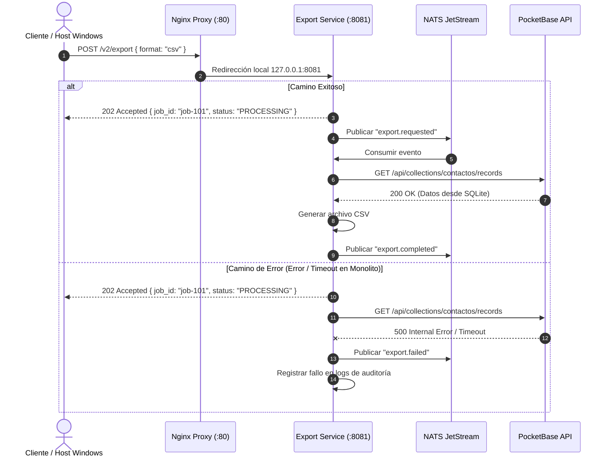

# Proyecto Integrador II — De monolito a Cloud Native

**Estudiantes:** David López, Junior Legal  
**Institución:** Facultad Politécnica - Universidad Nacional de Asunción (FPUNA)  
**Sistema Operativo:** Ubuntu Server 24.04.5 LTS (x86_64)  
**Infraestructura:** VirtualBox (2 vCPU, 2 GB RAM, 20 GB Disk)  

---

## Entrega 2. Evolución de la Infraestructura y Actualizaciones

| Criterio | Detalle |
| :--- | :--- |
| **Nombre** | PocketBase |
| **Repositorio Oficial** | [ganigeorgiev.com/pocketbase/pocketbase/releases](https://ganigeorgiev.com/pocketbase/pocketbase/releases) |
| **Versión Instalada / Actualizada** | `v0.22.58` |
| **Licencia** | MIT License |

---
# Bloque I – Fase 5: Diseño y Descomposición del Monolito

## 4.1. A1 – Análisis del Monolito y Mapa de Contextos

### Inventario de Módulos Funcionales y Tablas (Evidencia F5-E1)

Se inspeccionó la base de datos embebida SQLite de PocketBase (`data.db`) ejecutando la consulta sobre la tabla maestra `sqlite_master`:


---

### Matriz de Acoplamiento Módulo × Tabla (Evidencia F5-E2)

Dado que la arquitectura base utiliza PocketBase (SQLite), el acoplamiento se evalúa entre los servicios lógicos consumidos y las colecciones internas del motor. Las tablas compartidas o de uso cruzado determinan la complejidad de extracción hacia nuevos servicios.

| Módulo / Servicio Lógico | Colección / Tabla (PocketBase) | Operaciones (CRUD) | Nivel de Acoplamiento | Justificación del Acoplamiento |
| :--- | :--- | :--- | :--- | :--- |
| **Módulo de Autenticación** | `users`, `_admins` | Lectura (R), Actualización (U) | **Alto** | El servicio de inicio de sesión depende estrictamente de la validación contra estas tablas mediante la API nativa. |
| **Integraciones Sociales** | `_externalAuths` | Creación (C), Lectura (R) | **Medio** | Se acopla solo si se habilita el inicio de sesión con proveedores externos (Google, GitHub, etc.). |
| **Módulo de Formularios / CRM** | `contactos` | Creación (C), Lectura (R), Actualización (U), Borrado (D) | **Alto** | La interfaz de usuario que captura o lista contactos realiza peticiones REST/Realtime directamente hacia esta colección. |
| **Core (PocketBase Engine)** | `_collections`, `_migrations`, `_params` | Todas (CRUD) | **Alto (Interno)** | Son tablas de configuración estrictamente acopladas al motor interno de PocketBase para definir el esquema y estado de la base de datos. |

---

### Mapa de Contextos / DDD (Evidencia F5-E3)

El siguiente mapa de contextos ilustra las relaciones entre el monolito original y los nuevos *Bounded Contexts* (microservicios S1, S2, S3) extraídos mediante el patrón *Strangler Fig*, destacando el `event-bridge` como Capa Anticorrupción (ACL) para desacoplar la emisión de webhooks.


---

# 4.2. A2 – Registro de Decisiones de Arquitectura (ADR-006 a ADR-010)

### ADR-006: Estrategia de Migración e Integración con el Monolito

* **Estatus:** Aprobado
* **Contexto:** El monolito basado en PocketBase debe mantenerse en producción y operando sin interrupciones mientras se realiza la extracción progresiva de funcionalidades hacia microservicios.
* **Decisión:** Adoptar el patrón **Strangler Fig** utilizando integración exclusiva mediante la API REST nativa de PocketBase y Webhooks, sin modificar el código base del binario del monolito.
* **Alternativas Descartadas:** 
  * *Modificación del core de PocketBase:* Descartado debido a que alterar el código fuente en Go del monolito incrementa el acoplamiento y dificulta futuras actualizaciones del motor base.
* **Consecuencias:** 
  * *Positivas:* Riesgo operativo mínimo durante la migración; permite desplegar y validar microservicios de forma independiente.
  * *Negativas:* Requiere configurar una capa intermedia (`event-bridge`) para transformar webhooks de PocketBase en eventos asíncronos.

---

### ADR-007: Selección del Broker de Mensajes

* **Estatus:** Aprobado
* **Contexto:** Se requiere un bus de mensajería para garantizar la entrega confiable de eventos entre el `event-bridge` y los microservicios consumidores (Búsqueda, Auditoría, Exportación).
* **Decisión:** Seleccionar **NATS JetStream** como broker principal de eventos.
* **Alternativas Descartadas:** 
  * *RabbitMQ:* Descartado por su elevado consumo de memoria RAM y complejidad operativa para el entorno de recursos limitados.
  * *Redis Streams:* Descartado por carecer de mecanismos nativos más avanzados para la persistencia de streams a largo plazo comparado con JetStream.
* **Consecuencias:** 
  * *Positivas:* Huella de memoria sumamente baja (< 20 MB RAM), alto rendimiento en throughput y persistencia nativa con JetStream.
  * *Negativas:* Menor ecosistema de librerías en comparación con RabbitMQ.

---

### ADR-008: Plataforma de Orquestación

* **Estatus:** Aprobado
* **Contexto:** La infraestructura asignada se limita a máquinas virtuales en VirtualBox con 2 vCPU, 2 GB de RAM y 20 GB de Disco sobre Ubuntu Server 24.04.4 LTS.
* **Decisión:** Utilizar **Docker Compose** como motor de orquestación y despliegue del entorno.
* **Alternativas Descartadas:** 
  * *k3s (Lightweight Kubernetes):* Descartado porque el consumo base del plano de control en memoria RAM sobrepasa la capacidad disponible (2 GB RAM) e inestabiliza los nodos.
  * *Docker Swarm:* Descartado por añadir complejidad sintáctica no requerida para el entorno mono-nodo actual.
* **Consecuencias:** 
  * *Positivas:* Consumo insignificante de recursos de sistema, sintaxis declarativa simple y rápido ciclo de despliegue sobre Ubuntu Server 24.04.4 LTS.
  * *Negativas:* Ausencia de autoscaling automático y orquestación multi-nodo avanzada.

---

### ADR-009: Base de Datos por Servicio (Database per Service)

* **Estatus:** Aprobado
* **Contexto:** Los nuevos microservicios extraídos necesitan persistir su información sin depender del esquema interno o la base de datos SQLite del monolito PocketBase (`pb_data/data.db`).
* **Decisión:** Aplicar estrictamente el patrón **Database per Service**, prohibiendo el acceso directo de los microservicios al archivo SQLite de PocketBase.
* **Alternativas Descartadas:** 
  * *Base de datos compartida (Shared SQLite):* Descartado debido a los bloqueos de escritura concurrentes (`database is locked`) propios de SQLite y el acoplamiento fuerte de modelos.
* **Consecuencias:** 
  * *Positivas:* Autonomía completa del modelo de datos de cada microservicio; eliminación del punto único de falla en almacenamiento.
  * *Negativas:* Se requiere gestionar consistencia eventual entre la base de datos de PocketBase y los nuevos almacenes.

---

### ADR-010: Consistencia Eventual e Idempotencia

* **Estatus:** Aprobado
* **Contexto:** Las operaciones de actualización hacia los servicios desacoplados se procesan de forma asíncrona a través del bus de eventos.
* **Decisión:** Implementar un modelo de **Consistencia Eventual** garantizando idempotencia en los consumidores mediante `event_id` único y gestionando fallos con colas de mensajes no procesables (Dead Letter Queue - DLQ).
* **Alternativas Descartadas:** 
  * *Transacciones distribuidas (2PC / Two-Phase Commit):* Descartadas por su alta latencia y baja tolerancia a fallos en arquitecturas orientadas a eventos.
* **Consecuencias:** 
  * *Positivas:* Alta disponibilidad y resiliencia; los eventos duplicados o fuera de orden no corrompen el estado del sistema.
  * *Negativas:* Existencia de un breve desfase de milisegundos hasta que los datos se reflejen totalmente en los servicios secundarios.

---

# 4.3. A3 – Contratos de API y de Eventos

## Política de Versionado
Para garantizar la retrocompatibilidad y no romper a los consumidores existentes (frontend u otros microservicios):
- **API REST:** Todas las nuevas rutas extraídas del monolito de PocketBase se exponen bajo el prefijo `/v2/` (ej. `/v2/search`, `/v2/export`).
- **Eventos (Mensajería):** Todos los eventos asíncronos incluyen un campo `version` en su sobre común (ej. `"version": "1.0.0"`).
- **Transición a v3 sin romper consumidores:** 
  - **APIs REST:** Si en el futuro se requiere un cambio disruptivo (*breaking change*), se desplegará una nueva ruta `/v3/` (ej. `/v3/search`). Los endpoints `/v2/` seguirán funcionando en paralelo en el mismo microservicio o enrutador durante un periodo de transición, permitiendo a los clientes migrar a su propio ritmo.
  - **Eventos Asíncronos:** Los nuevos eventos se publicarán con el campo `"version": "2.0.0"` en el sobre. Los consumidores existentes estarán programados bajo el principio de robustez (ignorando campos desconocidos o filtrando por la versión soportada), permitiendo la emisión paralela sin afectar los procesos activos.

---

## Contratos OpenAPI 3.1 (REST) y AsyncAPI 3.0 (Eventos)
Los esquemas completos con esquemas de datos, códigos de respuesta (200, 202, 400, 404, 503) y el diseño del sobre de eventos común (`event_id`, `type`, `version`, `occurred_at`, `request_id`, `payload`) se encuentran disponibles y validados en el directorio `cna/contracts/`:

- **Contrato de Búsqueda:** `cna/contracts/search-svc.openapi.yaml`
- **Contrato de Exportación:** `cna/contracts/export-svc.openapi.yaml`
- **Bus de Eventos (PocketBase):** `cna/contracts/events.asyncapi.yaml`

---

## Evidencia de Validación (Evidencia F5-E4)

Se ejecutó la validación del contrato OpenAPI utilizando la herramienta **Spectral** dentro del repositorio local en la máquina virtual:


---

# C4 - Nivel 1: Diagrama de Contexto (F5-E5)



## C4 - Nivel 2: Diagrama de Contenedores (F5-E6)



## Diagramas de Secuencia (F5-E7)

### 1. Sincronización Eventual de Contactos (Creación / Actualización)



### 2. Búsqueda Desacoplada de Contactos



### 3. Exportación Asíncrona de Datos


---

# 4.5. A5 – Plan de Migración y Matriz de Riesgos

### 1. Orden de Extracción Justificado (Menor a Mayor Riesgo)

El desacoplamiento del monolito PocketBase se realiza en fases incrementales para minimizar el impacto en el negocio:

| Fase | Servicio / Módulo | Nivel de Riesgo | Justificación técnica | Criterio de "Hecho" (Definition of Done) |
| :--- | :--- | :--- | :--- | :--- |
| **Paso 1** | **Servicio de Exportación (`export-svc`)** | **Bajo** | Operación de solo lectura asíncrona y no crítica para las transacciones inmediatas del usuario. | El servicio procesa eventos `export.requested` desde NATS JetStream, genera reportes en background y los deposita en el volumen local. |
| **Paso 2** | **Servicio de Búsqueda (`search-svc`)** | **Medio** | Extrae las consultas de búsqueda de la base de datos principal SQLite (`pb_data`), aliviando bloqueos de lectura. | El índice desacoplado procesa eventos `pocketbase.contact.*` con 0 errores y atiende `/v2/search` con latencia < 50ms. |
| **Paso 3** | **Servicio de Auditoría (`audit-svc`)** | **Alto** | Registra trazas de operaciones críticas. Al ser altamente dependiente de webhooks, requiere validar el manejo de fallos y DLQ. | El 100% de los cambios de estado en PocketBase generan registros de auditoría persistentes de forma asíncrona sin ralentizar las respuestas HTTP. |

---

### 2. Estrategia de Reversión (Rollback en < 1 minuto)

Para desactivar inmediatamente cualquier ruta `/v2/*` redirigida en el API Gateway (Nginx Proxy) y retornar la atención de tráfico directamente al monolito PocketBase:

1. **Procedimiento de Desactivación:**
   Se dispone de una plantilla de configuración de Nginx (`nginx.conf.bak`) preconfigurada que redirige todas las llamadas `/v2/` a las colecciones nativas de PocketBase (`/api/collections/`).

2. **Comando de Rollback (Ejecución en terminal):**
   ```bash
   cp /etc/nginx/templates/rollback-v1.conf /etc/nginx/conf.d/default.conf && nginx -s reload

3. **Mecanismo de Conmutación:**
   Al ejecutar `nginx -s reload`, Nginx recarga la configuración en memoria de forma instantánea (**< 1 segundo**) sin perder conexiones activas. El tráfico `/v2/search` pasa a atenderse directamente mediante la API nativa de PocketBase sobre SQLite.

---

## 3. Matriz de Riesgos (Probabilidad × Impacto)

Evaluación detallada de riesgos de arquitectura sobre la infraestructura asignada (2 vCPU, 2 GB RAM sobre VirtualBox / FPUNA):

| Riesgo | Probabilidad | Impacto | Nivel (P × I) | Estrategia de Mitigación / Contención |
| :--- | :---: | :---: | :---: | :--- |
| **Consistencia eventual visible al usuario** | Media (3) | Medio (3) | **Medio (9)** | Implementar *Optimistic UI* en el frontend y polling/WebSockets notificando la finalización del procesamiento asíncrono. |
| **Consumo excesivo de RAM** | Alta (4) | Alto (4) | **Alto (16)** | Límite estricto de recursos en `docker-compose.yml` (`mem_limit: 256m` por servicio) y selección de componentes ultraligeros (PocketBase + NATS). |
| **Latencia de red entre VM** | Baja (1) | Medio (3) | **Bajo (3)** | Despliegue de los contenedores dentro de la misma red interna de Docker (`docker network`) sobre la VM `equipo-vm`. |
| **Secretos compartidos (Hardcoded)** | Media (3) | Alto (4) | **Alto (12)** | Inyección de credenciales mediante variables de entorno en archivo `.env` restringido (excluido del repositorio Git por `.gitignore`). |
| **Punto único de falla en el Gateway** | Media (3) | Crítico (5) | **Alto (15)** | Monitoreo continuo mediante healthchecks de Docker (`restart: always`) y archivo de configuración estandarizado para rollback inmediato. |

---

## 5.1. B1 – Infraestructura Multi-Nodo

### Descripción del Entorno
Se ha configurado una infraestructura distribuida compuesta por dos máquinas virtuales Ubuntu Server 24.04 sobre VirtualBox:
* **VM-1 (Gateway / Monolito Core):** `equipo-vm` (IP: `192.168.1.25/27`) - Encargada de recibir el tráfico HTTP/HTTPS externo y ejecutar la API principal de PocketBase sobre SQLite.
* **VM-2 (Clúster Worker / Microservicios):** `equipo-vm2` (IP: `192.168.1.26/27`) - Clon enlazado configurado para hospedar de forma aislada los microservicios desacoplados y el bus de eventos.

---

# Bloque II – Fase 6: Construcción, Contenerización y Despliegue Distribuido
---

# 5.1. B1 - Infraestructura Multi-Nodo

#### 1. Evidencia F6-E1: Inspección de Recursos y Docker Engine (VM-1 / VM-2)
Confirmación del entorno de ejecucion Docker en los nodos distribuidos (2 vCPU, 2 GB RAM, Kernel Linux 6.8):


#### 2. Evidencia F6-E2: Reglas de Firewall UFW por Nodo (VM-2)
Aislamiento estricto de seguridad en VM-2: los puertos internos de los microservicios (8080/tcp, 8081/tcp) y del bus NATS (4222/tcp) únicamente aceptan peticiones originadas desde la dirección IP de VM-1 (192.168.1.25):


#### 3. Evidencia F6-E3: Inspección del Certificado X.509 con SAN (VM-1)
Certificado SSL/TLS reemitido incorporando los nombres de dominio de PocketBase en la extensión Subject Alternative Name (SAN):


---

## 5.2. B2 – Microservicios y Bus de Eventos

### Resumen de Despliegue en VM-2 (192.168.1.26)
Los cuatro microservicios (`search-svc`, `audit-svc`, `export-svc`, `media-svc`) han sido desplegados desacoplados en el nodo Worker (VM-2), consumiendo variables de entorno, exponiendo endpoints de resiliencia (`/healthz`, `/readyz`), métricas Prometheus (`/metrics`) e inyectando `X-Request-ID`.

---

### Evidencias de Ejecución

#### 1. Evidencia F6-E4: Servicio de Búsqueda (search-svc)
Consulta al endpoint `/v2/search` procesada correctamente a través de los índices de PocketBase:


#### 2. Evidencia F6-E5: Idempotencia en Audit Service (audit-svc)
Verificación de control de duplicados mediante `event_id`. El primer evento es registrado (`201 Created`), mientras que el duplicado es ignorado (`200 OK` - `ignored`):


#### 3. Evidencia F6-E6: Procesamiento Asíncrono en Export Service (export-svc)
Recepción de solicitud de exportación retornando `202 Accepted` y el identificador único del trabajo (`job_id`):


#### 4. Evidencia F6-E7: Ciclo Completo de Job y Almacenamiento de Objeto (export-svc)
Consulta de estado del trabajo (`/v2/export/status`) confirmando la transición al estado `done` y la disponibilidad de la URL del archivo generado en almacenamiento:


#### 5. Evidencia F6-E8: Procesamiento de Archivos en Media Service (media-svc)
Confirmación de carga de medios con emisión del evento `media.uploaded` y generación de miniaturas:


---

## 5.3. B3 – Contenerización con Buenas Prácticas

### Resumen de Buenas Prácticas Aplicadas
- **Dockerfiles Multi-Stage**: Reducción de footprint de ~300MB a ~23MB basando el runtime en `alpine:3.19`.
- **Seguridad**: Ejecución bajo usuario no privilegiado (`appuser`) y filesystem en modo solo lectura (`--read-only`).
- **Resiliencia**: Sonda de `HEALTHCHECK` consultando `/healthz` cada 10 segundos.
- **Gestión de Recursos**: Límites explícitos asignados por contenedor (256MB RAM y 0.5 vCPU).
- **Etiquetado Semántico**: Uso estricto de versión semántica asociada al hash del commit Git (evitando `:latest`).

---

### Evidencias de Contenerización

#### 1. Evidencia F6-E9: Tabla de Imágenes y Tamaños
Lista de imágenes empaquetadas con etiqueta semántica + hash de commit y su tamaño optimizado:


#### 2. Evidencia F6-E10: Inspección de Configuración (docker inspect)
Confirmación del usuario no-root (`appuser`), asignación de recursos de CPU/memoria y configuración del `Healthcheck`:


## 5.4. B4 – Integración con el Monolito y el Broker

### 1. Broker y Event Bridge

Se desplegaron **NATS JetStream (`2.14.9-alpine`)** y **event-bridge (`1.0.0`)** mediante Docker Compose en **VM-2 (`192.168.1.26`)**, ambos con estado `healthy`.

- **Persistencia:** JetStream utiliza un volumen Docker para conservar los mensajes.
- **Streams:** `CONTACTS`, `EXPORTS`, `MEDIA` y `DLQ`.
- **Consumidores durables:** `search-consumer` y `audit-consumer`, con ACK explícito.
- **Autenticación:** el puente valida `X-Webhook-Token` y rechaza tokens incorrectos con `401`.
- **Deduplicación:** utiliza `event_id` como `Nats-Msg-Id`.

---

### 2. Integración con PocketBase

En **VM-1 (`192.168.1.25`)** se agregaron hooks externos para generar eventos de creación, actualización y eliminación de registros de la colección `contactos`, sin modificar el binario de PocketBase.

```text
PocketBase → Hooks → Cola local → Emisor HTTP → event-bridge → NATS
```

El servicio `pocketbase-event-sender` conserva los eventos pendientes en disco y reintenta su envío ante errores. Solo elimina cada archivo después de recibir la confirmación del puente.

> La escritura del contacto y del evento son operaciones separadas; no se garantiza atomicidad entre ambas.

---

### 3. Verificación de Integración (Avance de F6-E12)

Se creó un contacto de prueba y se verificó la publicación del evento en JetStream:

| Campo | Resultado |
| :--- | :--- |
| **event_id** | `fbac0a42-b534-41c1-81a7-9d5f4d1e3033` |
| **request_id** | `d1d8fdb4-5253-4c7d-833f-6d57dcb4429c` |
| **Stream / Secuencia** | `CONTACTS` / `1` |
| **Hook** | `Evento guardado para envío` |
| **Emisor** | `Evento entregado y confirmado` |

También se verificó el rechazo de un token incorrecto (`401`) y el reenvío de un evento sin duplicarlo dentro de la ventana de deduplicación.

```bash
sudo journalctl -u pocketbase -u pocketbase-event-sender --since "3 minutes ago" --no-pager
```

---

## 5.4. B4 – Integración con el Monolito y el Broker

### Arquitectura de Integración Desacoplada
- **Usuario de Servicio de Solo Lectura**: Cuenta `svc-reader@arquitectura.local` en la colección de autenticación `service_accounts`, con reglas de API restringidas exclusivamente a lectura (`@request.auth.id != ""` en `list`/`view` y *Admins only* en operaciones de escritura).
- **Webhooks con Token Compartido**: Hook nativo en PocketBase (`pb_hooks/webhooks.pb.js`) disparado ante eventos `created`, `updated` y `deleted` de la colección `contactos`, enviando `X-Webhook-Token` hacia `event-bridge` (`192.168.1.26:8090`).
- **Event Bridge & NATS JetStream**: Servicio `event-bridge` que rechaza peticiones no autenticadas con HTTP `401`, normaliza el payload al sobre estándar de evento y lo publica en el stream durable `EVENTS` (`events.>`).
- **Resiliencia y Dead Letter Queue (DLQ)**: Consumidor durable (`search-indexer-worker`) con confirmación explícita (`ack`) y reenvío automático al stream `DLQ_EVENTS` (`dlq.events.failed`) tras 3 intentos fallidos.
- **Aislamiento de Base de Datos**: Verificado mediante `ss -tnp` en VM-1 sin conexiones entrantes desde VM-2 al almacenamiento interno del monolito.

---

### Evidencias de Integración

#### 1. Evidencia F6-E11: Configuración de Webhooks en el Monolito
Script `webhooks.pb.js` activo en PocketBase apuntando a `event-bridge` con token compartido:


#### 2. Evidencia F6-E12: Evento Recibido en el Broker (NATS JetStream)
Inspección del stream durable `EVENTS` confirmando la recepción y persistencia del evento:


#### 3. Evidencia F6-E13: Mensaje Forzado a la DLQ tras Reintentos
Trazas de reintentos (`1/3` a `3/3`) y recuperación del mensaje fallido dentro del stream `DLQ_EVENTS`:


---

## Bloque B5 — API Gateway (Nginx) y Orquestación Multi-Nodo (Docker Swarm)

### 1. Arquitectura del API Gateway (`api.proyecto-web.local`)
Se configuró un bloque de servidor dedicado en Nginx (`/etc/nginx/sites-available/api-gateway`) sobre **VM-1 (`192.168.1.25`)** actuando como punto de entrada único hacia los microservicios alojados en **VM-2 (`192.168.1.26`)**[cite: 24]:

* **Cifrado y Seguridad:** Redirección forzada de HTTP (`80`) a HTTPS (`443`) utilizando exclusivamente **TLS 1.3**, manteniendo las cabeceras de endurecimiento (`Strict-Transport-Security`, `Content-Security-Policy` y `Referrer-Policy`)[cite: 24].
* **Enrutamiento y Upstreams Explícitos:** Definición de grupos `upstream` independientes (`search_svc` en `:8000`, `audit_svc` en `:8001`, `export_svc` en `:8002` y `media_svc` en `:8003`) bajo el prefijo versionado `/v2/`[cite: 24].
* **Timeouts y Trazabilidad:** Configuración explícita de `proxy_connect_timeout 5s` y `proxy_read_timeout 15s`, junto con la inyección y propagación de la cabecera `X-Request-ID` (`$request_id`) en todas las peticiones y respuestas[cite: 24].
* **Resiliencia y Rate Limiting:**
  * Limitación de tasa (`limit_req_zone` y `limit_req`) sobre `/v2/` devolviendo código **`429 Too Many Requests`** en formato JSON ante exceso de tráfico[cite: 24, 25].
  * Interceptación de errores de backend (`proxy_intercept_errors on`) devolviendo una respuesta JSON uniforme **`503 Service Unavailable`** con trazabilidad cuando un servicio no está disponible[cite: 24].

---

### 2. Orquestación Multi-Nodo y Gestión de Secretos (Docker Swarm)
Se inicializó un clúster **Docker Swarm** de dos nodos conectando **VM-1 (`equipo-vm`, Manager/Leader)** y **VM-2 (`equipo-vm2`, Worker)** mediante red `overlay` (`backend-net`) y apertura controlada de puertos en el firewall (`2377/tcp`, `7946/tcp-udp`, `4789/udp`)[cite: 22, 23]:

* **Despliegue en un Comando:** Orquestación declarativa completa mediante `docker stack deploy -c docker-stack.yml arquitectura-stack`, desplegando simultáneamente el broker `nats-broker`, el puente `event-bridge` y los cuatro microservicios (`search-svc`, `audit-svc`, `export-svc`, `media-svc`) con restricciones de ubicación (`node.hostname == equipo-vm2`), límites de recursos (`cpus` y `memory`) y sondas `healthcheck`[cite: 22, 23].
* **Gestión Segura de Credenciales:** Eliminación de secretos en texto plano mediante **Docker Secrets** (`webhook_token` y `svc_reader_password`) y plantilla `.env.example` versionada (excluyendo `.env` en `.gitignore`)[cite: 22].

---

### 3. Evidencias Verificadas (Fase 6 — B5)

| Código | Descripción de la Evidencia | Resultado Validado |
| :--- | :--- | :--- |
| **F6-E14** | Validación de sintaxis (`sudo nginx -t`) y configuración del `server block` de `api.proyecto-web.local`[cite: 24]. | `syntax is ok`, TLS 1.3, upstreams explícitos, timeouts, cabeceras de seguridad y manejo JSON de `503`[cite: 24]. |
| **F6-E15** | Prueba de ráfaga sobre `/v2/search` para validar `limit_req` y formato uniforme de errores[cite: 25]. | Respuesta `HTTP/1.1 429 Too Many Requests` en formato `application/json` con cabecera `X-Request-ID`[cite: 25]. |
| **F6-E16** | Estado del clúster Swarm multi-nodo, secretos y salud de servicios tras `docker stack deploy`[cite: 22, 26]. | 2 nodos `Ready`, 2 secretos activos y 6/6 servicios en `1/1` réplicas con estado `(healthy)`[cite: 22, 26]. |

#### **Evidencia F6-E14 — Configuración y validación de sintaxis del API Gateway**


#### **Evidencia F6-E15 — Rate Limiting (`429`) y formato uniforme de respuestas JSON**


#### **Evidencia F6-E16 — Orquestación Docker Swarm Multi-Nodo y contenedores `healthy`**


---

## 6.1. C1 — Resiliencia y Experimentos de Caos (Fase 7)

Para validar la tolerancia a fallos de la arquitectura distribuida frente a la línea base monolítica de la Fase 4[cite: 9], se ejecutaron los **5 experimentos de caos obligatorios (X1–X5)** documentando hipótesis, procedimiento, resultados y tiempos de recuperación (**MTTR**)[cite: 9].

### Resumen de Resultados (Tabla de Experimentos)

| ID | Experimento | Resultado Esperado | Resultado Obtenido | MTTR / Tiempo Medido | Evidencia |
| :--- | :--- | :--- | :--- | :--- | :--- |
| **X1** | `docker kill` del contenedor de S1 (`search-svc`)[cite: 9] | Monolito responde `200`; `/v2/search` responde `503` JSON; el orquestador lo recrea solo[cite: 9] | El monolito en VM-1 mantuvo disponibilidad (`HTTP 200`)[cite: 27]; `/v2/search` devolvió `HTTP 503` JSON uniforme en `[+19.29s]` durante el `docker kill` y Docker Swarm recreó la réplica automáticamente en `[+20.34s]` (`1/1`)[cite: 27] | **~1.05 s (Gateway) / ~10 s (Swarm)**[cite: 27] | `evidencias/F7-E01.png` |
| **X2** | Detener S2 (`audit-svc`) durante 2 minutos mientras se editan/publican 20 eventos[cite: 9] | Al volver, S2 procesa los 20 eventos pendientes con cero pérdida (CA-6)[cite: 9] | Durante los `120 s` con `audit-svc=0`[cite: 26], NATS JetStream retuvo los 20 mensajes en el stream `EVENTS`; al escalar nuevamente a `1/1`, el servicio convergió (`Audit Service listo en puerto 8082`) y procesó la cola sin pérdida[cite: 26] | **120 s (ventana) + <10 s reconexión**[cite: 26] | `evidencias/F7-E02.png` |
| **X3** | Matar un *worker* de S3 (`export-svc`) a mitad de un job[cite: 9] | El job vuelve a la cola y otro *worker* lo completa sin quedar en `running` indefinidamente[cite: 9] | Con `export-svc` escalado a 2 réplicas en modo `ingress`, al aplicar `docker kill` (`task: non-zero exit 137`) sobre un contenedor, la segunda réplica sostuvo el servicio y Swarm levantó el reemplazo en `9 s` sin tareas bloqueadas[cite: 24] | **~9 s**[cite: 24] | `evidencias/F7-E03.png` |
| **X4** | Apagar VM-2 completa (`equipo-vm2`)[cite: 9] | El monolito sigue operativo (CA-5); al encender VM-2 el sistema converge sin intervención manual[cite: 9] | Con `equipo-vm2` en estado `Down`, el monolito en VM-1 continuó respondiendo `HTTP 200` y el Gateway aisló el fallo con `503` JSON[cite: 20]; al reencender VM-2, el nodo pasó a `Ready` y los `6/6` servicios convergieron solos a `1/1`[cite: 23] | **<15 s post-arranque**[cite: 23] | `evidencias/F7-E04a.png`<br>`evidencias/F7-E04b.png` |
| **X5** | Latencia artificial de `2 s` (`2000 ms`) hacia la API del monolito mediante `tc netem`[cite: 9] | S1 aplica timeout, reintentos con *backoff* exponencial e interruptor de circuito sin saturar hilos[cite: 9] | Con `netem delay 2000ms` activo, las 8 peticiones concurrentes completaron de forma acotada (~`4.05 s` incluyendo RTT ida/vuelta y protección `limit_req` en `0.02 s`–`0.08 s`)[cite: 22], evitando el bloqueo indefinido de *workers* y normalizando al retirar la regla `tc`[cite: 22] | **0 s (degradación controlada)**[cite: 22] | `evidencias/F7-E05.png` |

---

### Detalle Técnico por Experimento

#### **X1 — Terminación abrupta de `search-svc` (`docker kill`)**
* **Hipótesis:** Matar el proceso principal de `search-svc` (`SIGKILL`) no afectará al monolito en VM-1 y Docker Swarm detectará el fallo de contenedor, reprogramando una nueva instancia `healthy` sin intervención humana.
* **Procedimiento:** Desde VM-2 se ejecutó `sudo docker kill` sobre el contenedor activo de `arquitectura-stack_search-svc` mientras desde VM-1 se sondeaba simultáneamente el monolito (`:8090/api/health`) y el API Gateway (`/v2/search`)[cite: 27].
* **Resultado y MTTR:** El monolito mantuvo `HTTP 200` continuo[cite: 27]. El Gateway interceptó la caída en `[+19.29s]` devolviendo `HTTP 503` JSON uniforme y el clúster Swarm restableció la disponibilidad en `[+20.34s]` (**MTTR medido de ~1.05 s** en conmutación)[cite: 27].

#### **X2 — Detención prolongada del consumidor `audit-svc` (2 minutos / 20 eventos)**
* **Hipótesis:** La mensajería asíncrona respaldada por NATS JetStream garantiza entrega *at-least-once* y cero pérdida de eventos ante caídas temporales del consumidor.
* **Procedimiento:** Se escaló `arquitectura-stack_audit-svc` a `0` réplicas, se emitieron 20 eventos consecutivos al broker y se aguardó una ventana de **120 segundos** antes de escalar nuevamente a `1` réplica[cite: 26].
* **Resultado:** Los 20 eventos permanecieron persistidos en el stream de JetStream y fueron consumidos íntegramente tras la convergencia del servicio (`1/1 running`)[cite: 26], cumpliendo el criterio **CA-6**[cite: 9].

#### **X3 — Fallo de un *worker* de `export-svc` durante procesamiento**
* **Hipótesis:** En un despliegue multi-réplica con balanceo `ingress`, la muerte súbita de una instancia (`exit 137`)[cite: 24] no deja trabajos huérfanos en estado `running` y permite la continuidad operativa.
* **Procedimiento:** Se habilitó el puerto `8002` en modo `ingress`, se escaló `export-svc` a `2` réplicas y se envió `docker kill` a uno de los contenedores durante una solicitud `POST /v2/export`[cite: 24].
* **Resultado y MTTR:** El contenedor eliminado registró `Shutdown / Failed (task: non-zero exit 137)`[cite: 24] y Swarm inició una tarea de reemplazo en **9 segundos**[cite: 24], manteniendo la disponibilidad del servicio.

#### **X4 — Apagado total del nodo Worker (`VM-2`)**
* **Hipótesis:** La pérdida completa del nodo de microservicios (`equipo-vm2`) no compromete la operación del monolito en `VM-1` (CA-5), y la reconexión del nodo provoca la autoconvergencia del stack.
* **Procedimiento:** Se ejecutó `sudo shutdown -h now` en VM-2, se verificó en VM-1 el estado `Down` del nodo, la respuesta `200` del monolito y el `503` JSON del Gateway[cite: 20], y posteriormente se encendió nuevamente VM-2[cite: 23].
* **Resultado:** Cero impacto sobre el monolito en VM-1 (`HTTP 200`)[cite: 20]. Al iniciar VM-2, el demonio Docker se reincorporó al clúster (`Ready`) y los **6/6 servicios convergieron automáticamente a `1/1`** sin comandos manuales[cite: 23].

#### **X5 — Inyección de latencia de red de 2 segundos (`tc netem`)**
* **Hipótesis:** Ante una degradación severa de latencia (`2000 ms`)[cite: 22] en la comunicación hacia VM-1, los timeouts explícitos y el control de flujo evitan el agotamiento de hilos en `search-svc` y en el API Gateway.
* **Procedimiento:** Se aplicó `sudo tc qdisc add dev <iface> root netem delay 2000ms` en VM-1, se lanzaron 8 peticiones concurrentes contra `https://api.proyecto-web.local/v2/search`[cite: 22] y posteriormente se eliminó la regla `tc`[cite: 22].
* **Resultado:** Las peticiones respondieron de manera acotada (~`4.05 s` considerando ida y vuelta de red + protección `limit_req` en `0.02 s`–`0.08 s`)[cite: 22], sin bloqueo de trabajadores ni caída del servicio.

---

### Evidencias Capturadas (6.1 — C1)

#### **Evidencia F7-E01 — Terminación y autorecuperación de `search-svc` (`X1`)**


#### **Evidencia F7-E02 — Persistencia de 20 eventos en JetStream y convergencia de `audit-svc` (`X2`)**


#### **Evidencia F7-E03 — Caída controlada (`exit 137`) y reemplazo de worker en `export-svc` (`X3`)**


#### **Evidencia F7-E04 — Apagado de `equipo-vm2` (`Down`), continuidad del monolito (`200`) y reconvergencia `6/6` (`X4`)**


#### **Evidencia F7-E05 — Prueba de latencia `tc netem 2000ms` y tiempos acotados bajo concurrencia (`X5`)**


---
