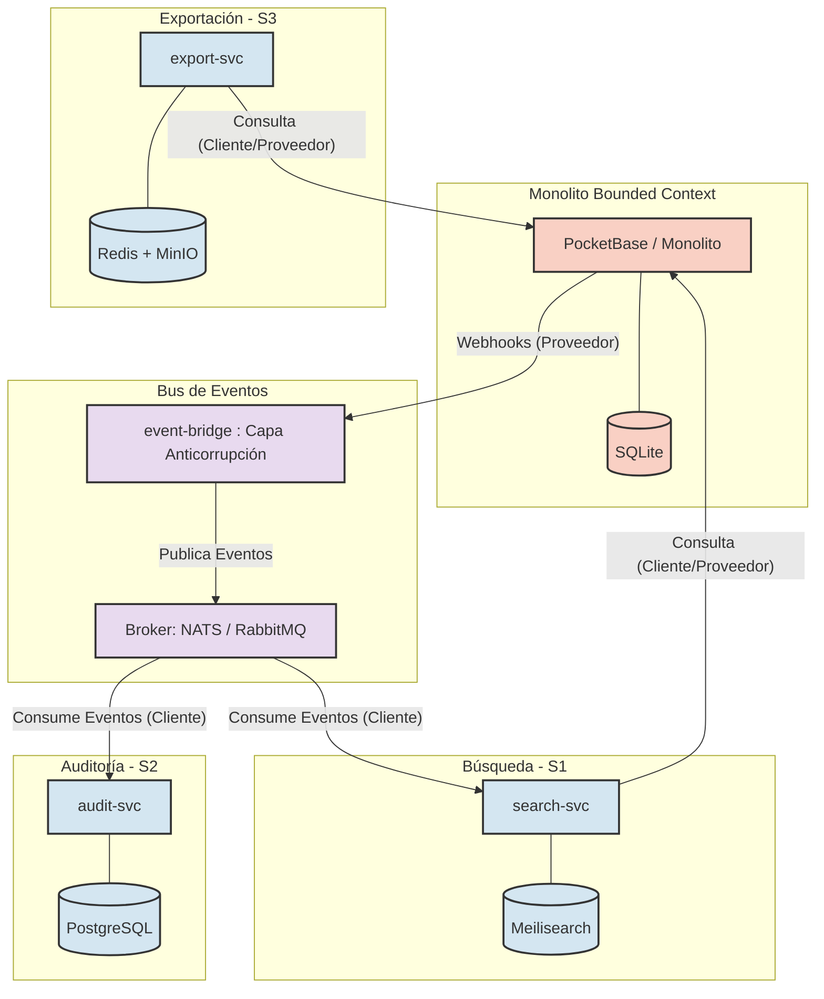

## 4.1. A1 – Análisis del Monolito y Mapa de Contextos

### Inventario de Módulos Funcionales y Tablas (Evidencia F5-E1)

Se inspeccionó la base de datos embebida SQLite de PocketBase (`data.db`) ejecutando la consulta sobre la tabla maestra `sqlite_master`:

---

### Matriz de Acoplamiento Módulo × Tabla (Evidencia F5-E2)

Dado que la arquitectura base utiliza PocketBase (SQLite), el acoplamiento se evalúa entre los servicios lógicos consumidos y las colecciones internas del motor. Las tablas compartidas o de uso cruzado determinan la complejidad de extracción hacia nuevos servicios.

| Módulo / Servicio Lógico | Colección / Tabla (PocketBase) | Operaciones (CRUD) | Nivel de Acoplamiento | Justificación del Acoplamiento |
| :--- | :--- | :--- | :--- | :--- |
| **Módulo de Autenticación** | `users`, `_admins` | Lectura (R), Actualización (U) | **Alto** | El servicio de inicio de sesión depende estrictamente de la validación contra estas tablas mediante la API nativa. |
| **Integraciones Sociales** | `_externalAuths` | Creación (C), Lectura (R) | **Medio** | Se acopla solo si se habilita el inicio de sesión con proveedores externos (Google, GitHub, etc.). |
| **Módulo de Formularios / CRM** | `contactos` | Creación (C), Lectura (R), Actualización (U), Borrado (D) | **Alto** | La interfaz de usuario que captura o lista contactos realiza peticiones REST/Realtime directamente hacia esta colección. |
| **Core (PocketBase Engine)** | `_collections`, `_migrations`, `_params` | Todas (CRUD) | **Alto (Interno)** | Son tablas de configuración estrictamente acopladas al motor interno de PocketBase para definir el esquema y estado de la base de datos. |

---

### Mapa de Contextos / DDD (Evidencia F5-E3)

El siguiente mapa de contextos ilustra las relaciones entre el monolito original y los nuevos *Bounded Contexts* (microservicios S1, S2, S3) extraídos mediante el patrón *Strangler Fig*, destacando el `event-bridge` como Capa Anticorrupción (ACL) para desacoplar la emisión de webhooks.

---

# 4.2. A2 – Registro de Decisiones de Arquitectura (ADR-006 a ADR-010)

### ADR-006: Estrategia de Migración e Integración con el Monolito

* **Estatus:** Aprobado
* **Contexto:** El monolito basado en PocketBase debe mantenerse en producción y operando sin interrupciones mientras se realiza la extracción progresiva de funcionalidades hacia microservicios.
* **Decisión:** Adoptar el patrón **Strangler Fig** utilizando integración exclusiva mediante la API REST nativa de PocketBase y Webhooks, sin modificar el código base del binario del monolito.
* **Alternativas Descartadas:** 
  * *Modificación del core de PocketBase:* Descartado debido a que alterar el código fuente en Go del monolito incrementa el acoplamiento y dificulta futuras actualizaciones del motor base.
* **Consecuencias:** 
  * *Positivas:* Riesgo operativo mínimo durante la migración; permite desplegar y validar microservicios de forma independiente.
  * *Negativas:* Requiere configurar una capa intermedia (`event-bridge`) para transformar webhooks de PocketBase en eventos asíncronos.

---

### ADR-007: Selección del Broker de Mensajes

* **Estatus:** Aprobado
* **Contexto:** Se requiere un bus de mensajería para garantizar la entrega confiable de eventos entre el `event-bridge` y los microservicios consumidores (Búsqueda, Auditoría, Exportación).
* **Decisión:** Seleccionar **NATS JetStream** como broker principal de eventos.
* **Alternativas Descartadas:** 
  * *RabbitMQ:* Descartado por su elevado consumo de memoria RAM y complejidad operativa para el entorno de recursos limitados.
  * *Redis Streams:* Descartado por carecer de mecanismos nativos más avanzados para la persistencia de streams a largo plazo comparado con JetStream.
* **Consecuencias:** 
  * *Positivas:* Huella de memoria sumamente baja (< 20 MB RAM), alto rendimiento en throughput y persistencia nativa con JetStream.
  * *Negativas:* Menor ecosistema de librerías en comparación con RabbitMQ.

---

### ADR-008: Plataforma de Orquestación

* **Estatus:** Aprobado
* **Contexto:** La infraestructura asignada se limita a máquinas virtuales en VirtualBox con 2 vCPU, 2 GB de RAM y 20 GB de Disco sobre Ubuntu Server 24.04.4 LTS (FPUNA).
* **Decisión:** Utilizar **Docker Compose** como motor de orquestación y despliegue del entorno.
* **Alternativas Descartadas:** 
  * *k3s (Lightweight Kubernetes):* Descartado porque el consumo base del plano de control en memoria RAM sobrepasa la capacidad disponible (2 GB RAM) e inestabiliza los nodos.
  * *Docker Swarm:* Descartado por añadir complejidad sintáctica no requerida para el entorno mono-nodo actual.
* **Consecuencias:** 
  * *Positivas:* Consumo insignificante de recursos de sistema, sintaxis declarativa simple y rápido ciclo de despliegue sobre Ubuntu Server 24.04.4 LTS.
  * *Negativas:* Ausencia de autoscaling automático y orquestación multi-nodo avanzada.

---

### ADR-009: Base de Datos por Servicio (Database per Service)

* **Estatus:** Aprobado
* **Contexto:** Los nuevos microservicios extraídos necesitan persistir su información sin depender del esquema interno o la base de datos SQLite del monolito PocketBase (`pb_data/data.db`).
* **Decisión:** Aplicar estrictamente el patrón **Database per Service**, prohibiendo el acceso directo de los microservicios al archivo SQLite de PocketBase.
* **Alternativas Descartadas:** 
  * *Base de datos compartida (Shared SQLite):* Descartado debido a los bloqueos de escritura concurrentes (`database is locked`) propios de SQLite y el acoplamiento fuerte de modelos.
* **Consecuencias:** 
  * *Positivas:* Autonomía completa del modelo de datos de cada microservicio; eliminación del punto único de falla en almacenamiento.
  * *Negativas:* Se requiere gestionar consistencia eventual entre la base de datos de PocketBase y los nuevos almacenes.

---

### ADR-010: Consistencia Eventual e Idempotencia

* **Estatus:** Aprobado
* **Contexto:** Las operaciones de actualización hacia los servicios desacoplados se procesan de forma asíncrona a través del bus de eventos.
* **Decisión:** Implementar un modelo de **Consistencia Eventual** garantizando idempotencia en los consumidores mediante `event_id` único y gestionando fallos con colas de mensajes no procesables (Dead Letter Queue - DLQ).
* **Alternativas Descartadas:** 
  * *Transacciones distribuidas (2PC / Two-Phase Commit):* Descartadas por su alta latencia y baja tolerancia a fallos en arquitecturas orientadas a eventos.
* **Consecuencias:** 
  * *Positivas:* Alta disponibilidad y resiliencia; los eventos duplicados o fuera de orden no corrompen el estado del sistema.
  * *Negativas:* Existencia de un breve desfase de milisegundos hasta que los datos se reflejen totalmente en los servicios secundarios.

---

### 5.3. B3 – Contenerización con Buenas Prácticas

En esta sección se rediseñó la estrategia de contenerización de los microservicios aplicando un enfoque de mínima superficie de ataque y optimización de recursos, cumpliendo con los siguientes criterios:

*   **Dockerfile Multi-stage:** Se implementó un *builder* temporal para compilar dependencias (`wheels`), dejando una imagen final `python:3.11-slim` limpia y ligera.
*   **Seguridad:** Ejecución con el usuario sin privilegios `appuser` (no-root) y sistema de archivos montado como solo lectura (`read_only: true`), utilizando `/tmp` para escrituras efímeras.
*   **Tolerancia a fallos:** Incorporación de la instrucción `HEALTHCHECK` en Dockerfile, sondeando el endpoint `/healthz` de forma nativa.
*   **Versionamiento:** Despliegue seguro prohibiendo la etiqueta `:latest`. Se utilizó versionamiento semántico ligado al hash del commit (Ej: `1.0.0-eba4c0b`).
*   **Límites (Cgroups):** Contenedores restringidos por diseño a `0.25` CPUs y `128m` de memoria RAM, garantizando que el sumatorio (512MB RAM) no sature el nodo.

📸 <b>Evidencia F6-E9: Tabla de Imágenes y Tamaño</b>

 

Listado de los microservicios compilados, mostrando el uso estricto de versionamiento semántico y la reducción de tamaño de las imágenes.

📸 <b>Evidencia F6-E10: Inspección de Seguridad y Límites (docker inspect)</b>

 

Validación mediante `docker inspect` al contenedor `search-svc` demostrando: usuario `appuser`, límite de RAM en bytes (128MB), límite de CPU (0.25), `ReadonlyRootfs: true` y la definición explícita del `HEALTHCHECK`.

